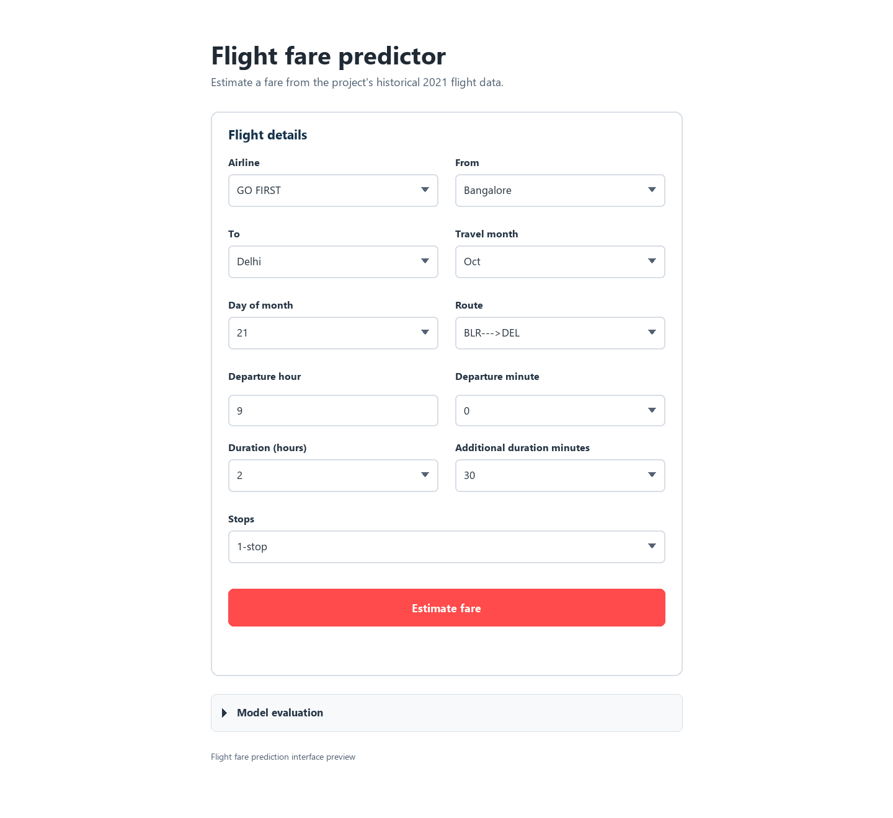
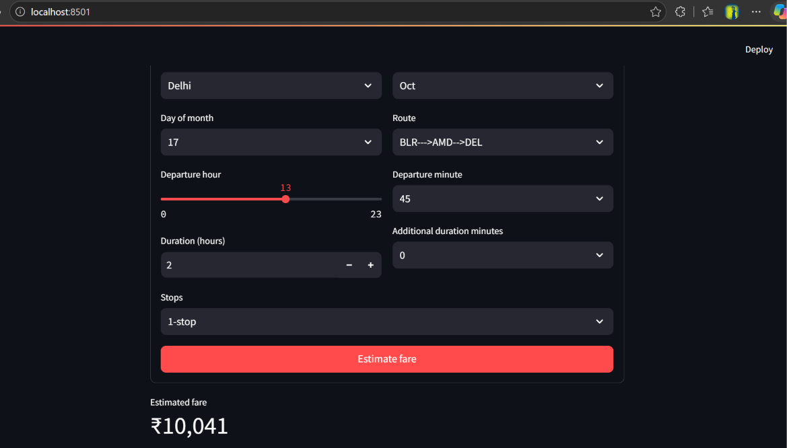

# Flight Fare Predictor

A small machine learning project that estimates Indian domestic flight fares from the flight details in the included historical dataset. It includes a reproducible model training pipeline and a Streamlit web interface.

> **Data limitation:** the supplied fares are from 2021. This app is for demonstration and learning; it does not fetch current airline prices and its estimates are not live quotes.

## Interface preview



The preview shows the form for choosing an airline, route, travel date, departure time, duration, and number of stops. After submitting the form, the app displays an estimated fare in Indian rupees.

## Dataset

The model uses `EasyMyTrip_yatra_Cleaned.csv`, which contains 7,699 cleaned fare records. Inputs include airline, source, destination, travel day and month, route, departure and arrival times, duration, and stops. The target is `price` in rupees. An additional source file, `EasyMyTrip_Yatra_2021.csv`, is also included in the repository.

## Model and evaluation

`train_model.py` cleans the target and numeric columns, imputes missing feature values, one-hot encodes categorical features, and trains an Extra Trees regression model. A fixed 80/20 random holdout split (seed 42) is used for the reported metrics.

| Metric | Holdout result |
| --- | ---: |
| Mean absolute error (MAE) | ₹868 |
| Root mean squared error (RMSE) | ₹1,812 |
| R² | 0.759 |

These scores describe performance on a random split of this historical dataset. They should not be interpreted as accuracy on current fares or future bookings.

## Run locally

Use Python 3.8 or newer. From the repository directory, create an environment, install dependencies, train the model, and start the app:

```powershell
python -m venv .venv
.\.venv\Scripts\Activate.ps1
python -m pip install -r requirements.txt
python train_model.py
python -m streamlit run app.py
```

Open the local URL printed by Streamlit, usually [http://localhost:8501](http://localhost:8501). To make the app available to other devices on the same network, Streamlit also prints a network URL when one is available. For a public deployment, deploy this repository to a Streamlit-compatible host and include the dataset and dependency file.

## Project files

- `app.py` — Streamlit interface and fare prediction.
- `train_model.py` — data preparation, training, and holdout evaluation.
- `requirements.txt` — Python dependencies.
- `EasyMyTrip_yatra_Cleaned.csv` — cleaned training dataset.
- `model_metrics.json` — metrics generated during training.
- `flight_price_model.joblib` — trained model generated during training.

The model artifact and metrics file are generated locally and excluded from version control. Rebuild them any time with `python train_model.py`.

